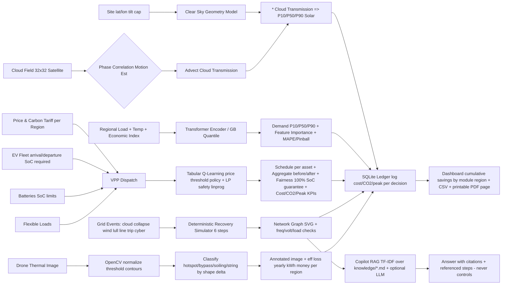

# Architecture – Energy Brain

## Workflow – Input → Processing → Output

## Model Selection Logic

- **Solar LSTM**: Solar irradiance time-series has diurnal seasonality + cloud stochasticity. LSTM captures sequential dependencies. Chosen for P10/P50/P90 quantile bands. Fallback Gradient Boosting quantile (sklearn) ensures offline reliability, CPU-only, fast training. Phase correlation for cloud motion is proven for satellite cloud advection.

- **Demand Transformer**: Industrial/regional load shows weekly seasonality and temperature sensitivity. Transformer encoder with attention can learn long-range (168h) dependencies better than LSTM. Attention summary shown as feature importance. Fallback GB quantile maintains monotonicity guarantee via post-sort.

- **VPP Dispatch RL+Optimizer**: Q-learning learns price threshold policy online (200 episodes, 3 actions). Lightweight, CPU, explainable. Rolling-horizon LP (scipy linprog HiGHS) guarantees feasibility: SoC delivery, transformer limit, cycle limits. Safety layer pattern ensures SoC never violated even if RL fails. Baseline immediate charging for side-by-side comparison.

- **Grid Copilot LLM+RAG** only for explanation: Regulatory requirement – LLM never controls grid. RAG over small local knowledge base (markdown) using TF-IDF/keyword overlap. If API key present, could call LLM, else rule-based grounded answers that still cite doc and simulation step.

- **Thermal**: OpenCV classic CV pipeline reliable for thermal hotspots without heavy ML. Connected components + shape heuristics (aspect ratio, area, delta T) classify defects. Optional CNN patch classifier if torch available.

## Failure Fallbacks

- All connectors synthetic fallback, flag source live/synthetic.
- Torch optional: try import, else sklearn.
- linprog fails → greedy cheapest-hours fallback.
- Cloud motion FFT fails → block matching.
- Thermal OpenCV missing → synthetic sample still works.
- Backend caches artifacts, model status endpoint reports readiness.

## Explainability Design

Every API returns `explain` with top drivers, counterfactual ("what if immediate"), confidence, data source, model version. Frontend Explain drawer shows these. Ledger shows methodology tooltip (marginal vs average). Trust page documents fairness, bias, privacy.

## Data Provenance

- Solar: clear-sky model (declination, hour angle, zenith) × cloud transmission.
- Demand: synthetic multi-site: base load * daily_profile * temp_effect * economic sin.
- Price/Carbon: region profile tariffs.
- All flagged source.
